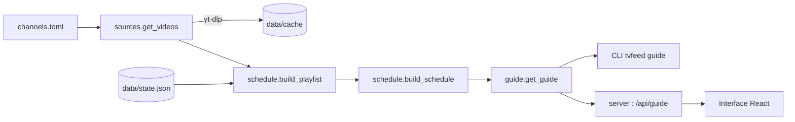

# Fonctionnement

## Vue d'ensemble



1. [`config`][tvfeed.config] lit les chaînes depuis `channels.toml`.
2. [`sources`][tvfeed.sources] récupère les vidéos de chaque source avec yt-dlp, en parallèle,
   sans clé d'API. Les résultats sont mis en cache 6 h dans `data/cache/`.
3. [`schedule`][tvfeed.schedule] mélange les vidéos de la chaîne et calcule la grille.
4. [`guide`][tvfeed.guide] assemble le tout et gère l'état ; il est partagé par la ligne de
   commande et par le [`server`][tvfeed.server].

## Récupération des vidéos

yt-dlp est utilisé en mode « flat » : il lit la liste des vidéos sans ouvrir chaque page,
ce qui suffit pour obtenir titre et durée. Une URL de chaîne sans onglet est redirigée vers
l'onglet `/videos`, ce qui exclut les shorts et les lives. Les vidéos sans durée (live,
première à venir) sont ignorées.

## Grille déterministe

Chaque chaîne a, dans `data/state.json` :

- une **graine** qui fixe l'ordre du mélange ;
- une **ancre** : l'instant où la playlist a démarré.

La playlist tourne en boucle depuis l'ancre. Connaissant l'heure, on sait donc quelle vidéo
passe et où on en est : en allumant une chaîne, on tombe en cours de vidéo, et la grille
reste la même d'un lancement à l'autre. `tvfeed shuffle` tire une nouvelle graine et une
nouvelle ancre.

!!! warning "Limite connue"
    Quand le cache se rafraîchit et que de nouvelles vidéos apparaissent, la playlist change
    et la grille de la chaîne aussi.

## Serveur et interface

Le serveur ([FastAPI](https://fastapi.tiangolo.com)) ne fait rien en arrière-plan : il récupère
les vidéos uniquement quand l'interface demande le programme.

| Route                               | Rôle                                          |
| ----------------------------------- | --------------------------------------------- |
| `GET /api/guide?hours=4`            | Programme de toutes les chaînes               |
| `POST /api/shuffle`                 | Remélange tout, renvoie le nouveau programme  |
| `POST /api/channels/{nom}/shuffle`  | Remélange une chaîne, renvoie son programme   |
| `GET /api/videos/{id}/chapters`     | Chapitres d'une vidéo (cache sans expiration) |
| `POST /api/channels/{nom}/videos/{id}/mark` | Marque une vidéo « à revoir »         |
| `GET /api/channels`                 | Définition des chaînes                        |
| `POST /api/channels`                | Crée une chaîne                               |
| `PUT /api/channels/{nom}`           | Modifie ou renomme une chaîne                 |
| `DELETE /api/channels/{nom}`        | Supprime une chaîne                           |
| `PUT /api/channels/order`           | Réordonne les chaînes                         |
| `GET /api/iptv/filters`             | Pays et catégories du catalogue IPTV          |
| `GET /api/iptv/search?q=&country=&category=` | Recherche dans le catalogue IPTV    |
| `GET /api/ai`                       | Modèle d'IA locale disponible (ou `null`)     |
| `POST /api/assist/themes`           | Thèmes proposés par l'IA                      |
| `POST /api/assist/channels`         | Chaînes YouTube proposées                     |
| `DELETE /api/later/{id}`            | Remet une vidéo marquée dans sa chaîne        |
| `POST /api/later/{id}/done`         | Note une vidéo marquée comme vue              |

Les routes qui modifient le programme renvoient le nouveau programme ; la réponse de
`/api/guide` inclut aussi la liste `later` des vidéos à revoir.
| `/`                                 | Interface compilée (`web/dist`)               |

L'interface (`web/`) est une application React + Vite construite avec
[shadcn/ui](https://ui.shadcn.com). Elle affiche, pour chaque chaîne, la vidéo en cours avec
sa progression et les vidéos suivantes. Elle avance dans la grille seconde par seconde et
recharge le programme toutes les 15 minutes. Les composants shadcn sont dans
`web/src/components/ui/` et s'ajoutent avec `npx shadcn@latest add <composant>` depuis `web/`.

## Lecteur

Cliquer sur la vidéo en cours d'une chaîne ouvre le lecteur en haut de la page, calé sur la
grille : on arrive en cours de vidéo, comme en allumant la télé. La chaîne regardée est gardée
dans l'URL (`#Sciences`).

Le lecteur utilise l'[API IFrame de YouTube](https://developers.google.com/youtube/iframe_api_reference)
et ajoute ses propres commandes :

- chaîne précédente / suivante (zapping) ;
- revenir au début, reculer de 10 s, avancer de 30 s ;
- chapitre précédent / suivant, et liste des chapitres cliquable ;
- **retour au direct**, quand on s'est écarté de la grille.

Si l'auteur interdit la lecture hors de YouTube (erreurs 101/150 du lecteur), un message le
signale, avec un lien vers la vidéo sur YouTube à l'instant prévu par la grille et un bouton
pour passer à la chaîne suivante.

Un badge indique l'écart avec la grille : *En direct*, *Différé de…* ou *En avance de…*.
À la fin d'une vidéo, le lecteur rejoint le direct, qui a pu avancer si on a fait pause ou
reculé.

## Gestion des chaînes

Le panneau **Chaînes** liste les chaînes dans l'ordre de `channels.toml` ; cet ordre donne
leur numéro, donc leur raccourci clavier. On peut en ajouter, les modifier, les supprimer
et les réordonner.

- **Écriture** : [`config`][tvfeed.config] réécrit `channels.toml` avec
  [tomlkit](https://tomlkit.readthedocs.io), qui conserve commentaires et mise en forme.
- **Vérification** : à l'enregistrement, les sources ajoutées sont récupérées
  ([`check_sources`][tvfeed.guide.check_sources]). Une source illisible ou vide est refusée
  avec un message. Les vidéos récupérées restent en cache : la chaîne est prête aussitôt.
- **Renommage** : l'état de la chaîne (graine, ancre) et ses vidéos marquées suivent le
  nouveau nom ; le programme ne change pas.
- **Suppression** : l'état de la chaîne est supprimé ; ses vidéos marquées restent dans la
  liste « à revoir ».

Avec Docker, `channels.toml` est monté en lecture-écriture pour que ces modifications soient
enregistrées dans le fichier de l'hôte.

## Chaînes en direct (IPTV)

Une chaîne peut aussi être une chaîne de télévision en direct, prise dans le catalogue
[iptv-org](https://github.com/iptv-org/iptv). Elle se range dans la même liste numérotée
que les autres chaînes (raccourcis, zapping, ordre), mais **sans programme** : on la regarde
en direct.

Dans `channels.toml`, c'est une chaîne avec `kind = "iptv"` ; ses `sources` sont des flux
HLS (`.m3u8`), essayés dans l'ordre :

```toml
[[channel]]
name = "Latina"
kind = "iptv"
logo = "https://i.imgur.com/MOsWriY.png"
iptv_id = "Latina.pe"
themes = ["Peru", "General"]
sources = [
    "https://redirector.rudo.video/…/latina/latina.smil/playlist.m3u8",
    "http://190.93.224.42/LATINA/index.m3u8",
]
```

- **Catalogue** : [`iptv`][tvfeed.iptv] télécharge les fichiers de l'API iptv-org (chaînes,
  flux, logos, pays, catégories) et les garde 24 h dans `data/cache/iptv/`. Sont écartés :
  les chaînes fermées ou réservées aux adultes, et les flux qui exigent un `Referer` ou un
  `User-Agent` particulier, qu'un navigateur ne peut pas fournir.
- **Recherche** : par mots-clés (nom, autre nom, pays, catégorie ; accents ignorés), pays et
  catégorie. Le panneau **Chaînes → Chaîne en direct (IPTV)** permet de tester un flux dans
  un aperçu avant d'ajouter la chaîne. Le dernier pays choisi est retenu.
- **Ordre des flux** : HTTPS et nom de domaine d'abord, adresse IP brute ensuite, puis la
  meilleure qualité. À l'enregistrement, au moins un flux doit répondre.
- **Lecture** : [hls.js](https://github.com/video-dev/hls.js) (lecture native sous Safari).
  Si un flux échoue ou ne démarre pas en 15 s, le lecteur passe tout seul au suivant ; il
  affiche « flux n / m ».

!!! warning "Flux non officiels"
    iptv-org recense des flux accessibles publiquement, mais tous ne sont pas diffusés par
    la chaîne elle-même : certains, servis depuis une adresse IP, sont des rediffusions non
    officielles. Le tri des flux propose d'abord les sources les plus probablement
    officielles ; vérifiez ce que vous ajoutez.

Le programme des chaînes IPTV n'est pas disponible : iptv-org ne publie pas de guide, seulement
des outils pour en extraire de sites tiers. Ce pourra être un ajout facultatif.

## Aide à la création (IA locale facultative)

Le formulaire de chaîne propose deux aides :

- **Trouver des chaînes** (à côté des sources) : cherche des chaînes YouTube adaptées, avec
  leur nombre d'abonnés et leur description, et les ajoute aux sources en un clic. Les
  sources déjà présentes sont exclues ; celles utilisées par une autre chaîne locale sont
  signalées.
- **Suggérer** (à côté des thèmes) : propose des thèmes d'après les titres des vidéos
  récentes des sources.

L'IA passe par [Ollama](https://ollama.com). Elle est **facultative** : si Ollama ne répond
pas, « Suggérer » est masqué, et la recherche de chaînes utilise directement les thèmes
comme requêtes.

L'IA ne propose jamais de chaînes elle-même : un modèle local en invente facilement. Elle
formule des requêtes, et les chaînes viennent d'une vraie recherche YouTube (filtre
« Chaînes », via yt-dlp), donc existent forcément. Les résultats sont classés : chaînes
trouvées par plusieurs requêtes d'abord, très petites chaînes (moins de 1 000 abonnés) en
dernier.

Par défaut, le plus gros modèle installé est utilisé (`TVFEED_AI_MODEL` pour en choisir un).
Un petit modèle (1,5 B) répond vite mais formule de mauvaises requêtes ; un modèle d'une
trentaine de milliards de paramètres donne de bons résultats en une ou deux secondes une
fois chargé.

!!! note "Avec Docker"
    Le conteneur joint l'Ollama de l'hôte via `host.docker.internal` (configuré dans
    `compose.yaml`). Ollama n'écoute par défaut que sur `127.0.0.1` : lancez-le avec
    `OLLAMA_HOST=0.0.0.0` pour qu'il soit joignable depuis le conteneur.

## Vidéos à revoir (chaîne 0)

Dans le lecteur, **À revoir** (++m++) marque la vidéo en cours : elle quitte sa chaîne, et la
suivante démarre aussitôt. Les vidéos marquées sont enregistrées dans `data/later.json` et
forment la chaîne 0, affichée au-dessus des autres.

La chaîne 0 ne suit pas de grille : elle lit les vidéos dans l'ordre de marquage, chacune
depuis le début. Une vidéo vue jusqu'au bout (ou notée **Vue**) quitte la liste et ne revient
pas dans sa chaîne. **Remettre dans sa chaîne** la retire de la liste et la remet dans sa
chaîne d'origine.

Retirer une vidéo d'une playlist décalerait toute la grille. Pour l'éviter :

- le mélange est fait sur toutes les vidéos, puis les vidéos marquées sont filtrées : l'ordre
  des autres ne change pas ([`build_playlist`][tvfeed.schedule.build_playlist]) ;
- l'ancre de la chaîne est recalculée ([`anchor_at`][tvfeed.schedule.anchor_at]) pour que
  la vidéo suivante démarre maintenant au marquage, et que la vidéo en cours ne bouge pas
  quand une vidéo est remise dans sa chaîne.

### Raccourcis clavier

| Touche          | Action                              |
| --------------- | ----------------------------------- |
| ++up++ / ++down++       | Chaîne précédente / suivante        |
| ++1++ … ++9++   | Aller à la chaîne n (numéro affiché à côté de son nom) |
| ++esc++         | Fermer le lecteur                   |
| ++space++       | Lecture / pause                     |
| ++left++ / ++right++    | Reculer de 10 s / avancer de 30 s   |
| ++shift+left++ / ++shift+right++ | Chapitre précédent / suivant |
| ++home++        | Revenir au début                    |
| ++d++           | Retour au direct                    |
| ++m++           | Marquer à revoir                    |
| ++0++           | Vidéos à revoir                     |

La liste est aussi accessible depuis l'icône clavier en haut de la page. Un clic dans la
vidéo YouTube lui donnerait le focus clavier : la page le reprend aussitôt pour que les
raccourcis restent actifs (les raccourcis propres à YouTube sont donc remplacés par ceux-ci).

Les chapitres ne sont pas fournis par la récupération des listes (mode « flat ») : ils sont
lus à la demande, vidéo par vidéo, par [`get_chapters`][tvfeed.sources.get_chapters]
(environ 1 s, puis depuis le cache).

En production (Docker), Node ne sert qu'à compiler l'interface ; l'image finale ne contient
que Python.
