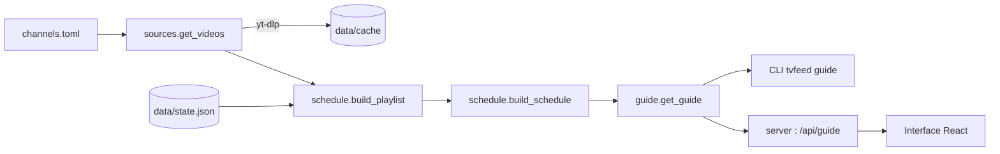

# Fonctionnement

## Vue d'ensemble

1. [`config`][tvfeed.config] lit les chaînes depuis `channels.toml`.
2. [`sources`][tvfeed.sources] récupère les vidéos de chaque source avec yt-dlp, en parallèle,
   sans clé d'API. Les résultats sont mis en cache 6 h dans `data/cache/`.
3. [`schedule`][tvfeed.schedule] mélange les vidéos de la chaîne et calcule la grille.
4. [`guide`][tvfeed.guide] assemble le tout et gère l'état ; il est partagé par la ligne de
   commande et par le [`server`][tvfeed.server].

## Récupération des vidéos

yt-dlp est utilisé en mode « flat » : il lit la liste des vidéos sans ouvrir chaque page,
ce qui suffit pour obtenir titre et durée. Une URL de chaîne sans onglet est redirigée vers
l'onglet `/videos`, ce qui exclut les shorts et les lives. Les vidéos sans durée (live,
première à venir) sont ignorées.

## Grille déterministe

Chaque chaîne a, dans `data/state.json` :

- une **graine** qui fixe l'ordre du mélange ;
- une **ancre** : l'instant où la playlist a démarré.

La playlist tourne en boucle depuis l'ancre. Connaissant l'heure, on sait donc quelle vidéo
passe et où on en est : en allumant une chaîne, on tombe en cours de vidéo, et la grille
reste la même d'un lancement à l'autre. `tvfeed shuffle` tire une nouvelle graine et une
nouvelle ancre.

!!! warning "Limite connue"
    Quand le cache se rafraîchit et que de nouvelles vidéos apparaissent, la playlist change
    et la grille de la chaîne aussi.

## Serveur et interface

Le serveur ([FastAPI](https://fastapi.tiangolo.com)) ne fait rien en arrière-plan : il récupère
les vidéos uniquement quand l'interface demande le programme.

| Route                               | Rôle                                          |
| ----------------------------------- | --------------------------------------------- |
| `GET /api/guide?hours=4`            | Programme de toutes les chaînes               |
| `POST /api/shuffle`                 | Remélange tout, renvoie le nouveau programme  |
| `POST /api/channels/{nom}/shuffle`  | Remélange une chaîne, renvoie son programme   |
| `/`                                 | Interface compilée (`web/dist`)               |

L'interface (`web/`) est une application React + Vite construite avec
[shadcn/ui](https://ui.shadcn.com). Elle affiche, pour chaque chaîne, la vidéo en cours avec
sa progression et les vidéos suivantes. Elle avance dans la grille seconde par seconde et
recharge le programme toutes les 15 minutes. Les composants shadcn sont dans
`web/src/components/ui/` et s'ajoutent avec `npx shadcn@latest add <composant>` depuis `web/`.

En attendant le lecteur intégré, cliquer sur la vidéo en cours l'ouvre sur YouTube à
l'instant courant.

En production (Docker), Node ne sert qu'à compiler l'interface ; l'image finale ne contient
que Python.
